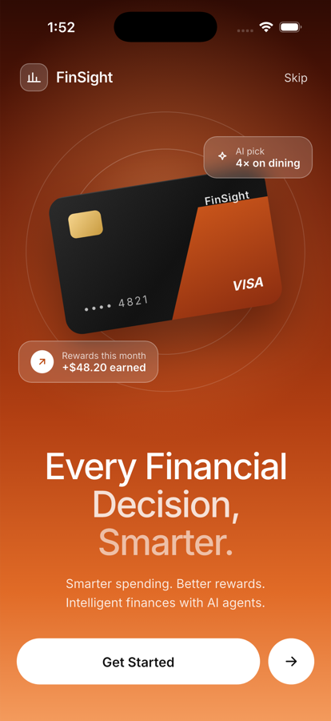
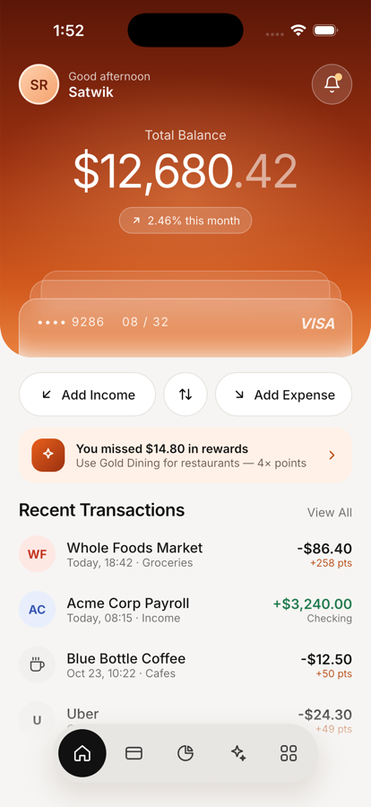
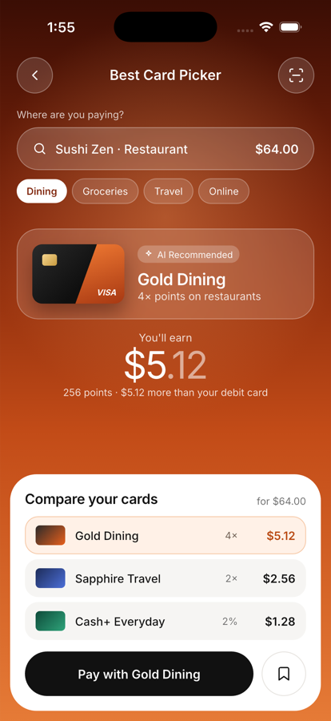
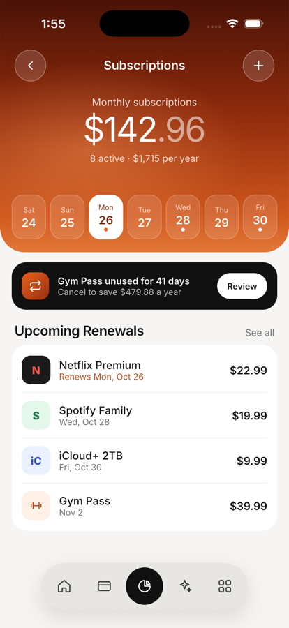
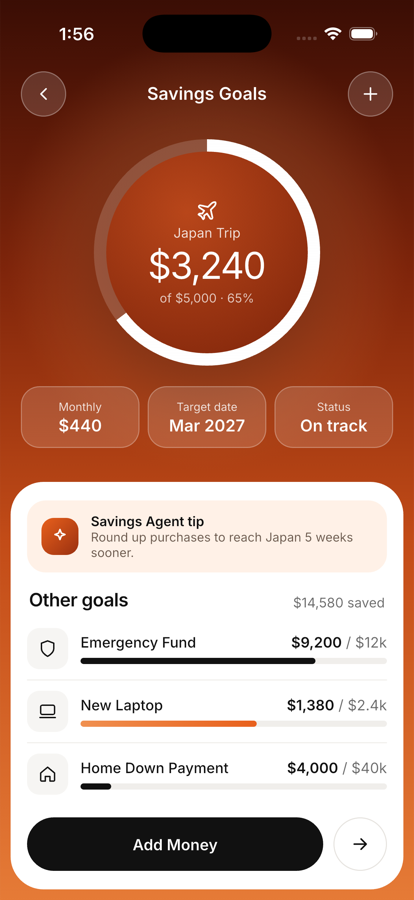
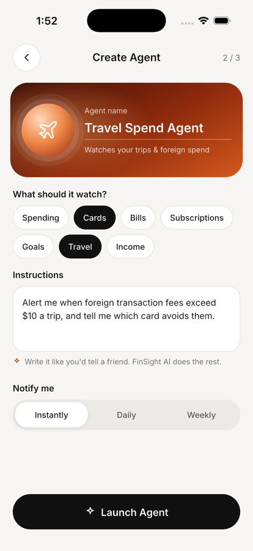
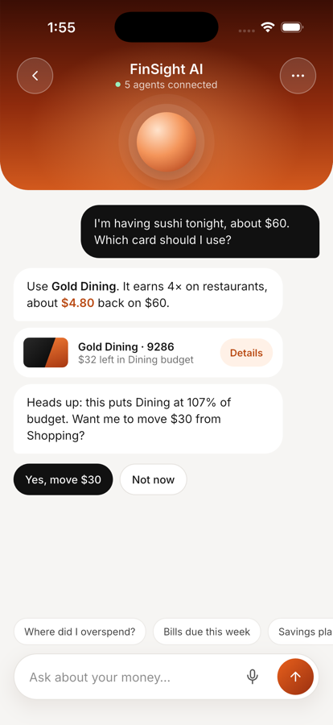

# FinSight AI

Flutter MVP of **FinSight**, a personal-finance app with smart card picking,
budgets, subscriptions, savings goals and AI agents. The UI follows the
FinSight Claude Design canvas (14 artboards: Welcome, Home, Smart Wallet,
Tap to Pay, Payment Complete, Best Card Picker, Expenses, Budgets,
Subscriptions, Savings Goals, AI Insights, AI Agents, Create Agent and
FinSight AI chat).

There is **no backend**. Everything the app shows comes from static JSON in
[`assets/data/`](assets/data/), and sign-in is checked against a local demo
account.

<p>
  
  
  
  
  
  
  
</p>

## Demo account

| Email | Password |
|-------|----------|
| `demo@finsight.app` | `FinSight@2026` |

It is defined in [`assets/data/users.json`](assets/data/users.json). On the
sign-in screen, **Use demo account** fills it in for you. The session is
remembered between launches; sign out from the avatar on Home.

These are throwaway MVP credentials with no server behind them. Replace this
file with real authentication before the app handles real data.

## Run it

Requires Flutter 3.47 (Dart 3.13) and Xcode with an iOS simulator.

```bash
flutter pub get
```

```bash
flutter run
```

## Tests

Unit and widget tests (reward maths, formatting, sign-in, app state):

```bash
flutter test
```

End-to-end flow on a simulator or device: signs in (including the error
cases), opens notifications, adds an expense, pays at Sushi Zen and switches
cards, checks budgets and the card picker, applies an insight, toggles and
creates agents, chats with FinSight AI, cancels a subscription, adds to a
savings goal and signs out.

```bash
flutter test integration_test -d <simulator-id>
```

## Project layout

```
assets/data/        Static JSON: users, overview, cards, transactions,
                    expenses, budgets, subscriptions, savings, insights,
                    agents, assistant script, pending payment
assets/fonts/       Inter (the design's typeface)
lib/
  main.dart         Loads the JSON, restores the session, starts the app
  router.dart       Routes and the floating-nav tab switching
  theme.dart        Design colours, Inter text helper, device metrics
  data/             JSON repository and AppState (session + in-memory edits)
  models/           Plain data classes parsed from the JSON
  screens/          One file per design artboard, plus sign-in
  widgets/          Icons, CSS-accurate gradients, nav pill, sheets, buttons
integration_test/   End-to-end flow test
test/               Unit and widget tests
```

Changes made in the app (payments, new expenses, toggled agents, cancelled
subscriptions, goal deposits, chat) live in memory for the session. Signing
out resets the demo to the bundled data.

## Notes on the design

The screens follow the artboards' sizes, spacing, colours, gradients and
copy. Where the MVP needed more than the canvas shows:

- **Sign-in screen**: the canvas has no login, so one was added in the
  Welcome screen's style (gradient, frosted fields, white pill button).
- **Reachability**: Subscriptions and Savings Goals have no link in the
  canvas. They open from the agent cards on AI Agents, from Home's
  notifications, and Savings from Home's transfer button.
- **Numbers are computed from the data**, so two figures differ from the
  canvas copy, which didn't add up: the card picker says *$5.12 more than
  your debit card* (debit earns nothing; the canvas said $3.84), and Payment
  Complete shows Dining at *108%* ($368 + $64 of $400; the canvas said 107%).
- **Taller iPhones**: the artboards are 390 × 844. On Dynamic Island phones
  top-anchored content moves down by the extra status-bar height, and lists
  scroll under a frosted status bar.
- Buttons with no destination in the canvas (add card, scan receipt, voice
  input, new goal) show a short "coming after the MVP" message.

## Third-party licences

- [Inter](https://github.com/rsms/inter): SIL Open Font License 1.1
  ([`assets/fonts/OFL.txt`](assets/fonts/OFL.txt))
- [flutter_svg](https://pub.dev/packages/flutter_svg): MIT
- [shared_preferences](https://pub.dev/packages/shared_preferences): BSD-3-Clause
